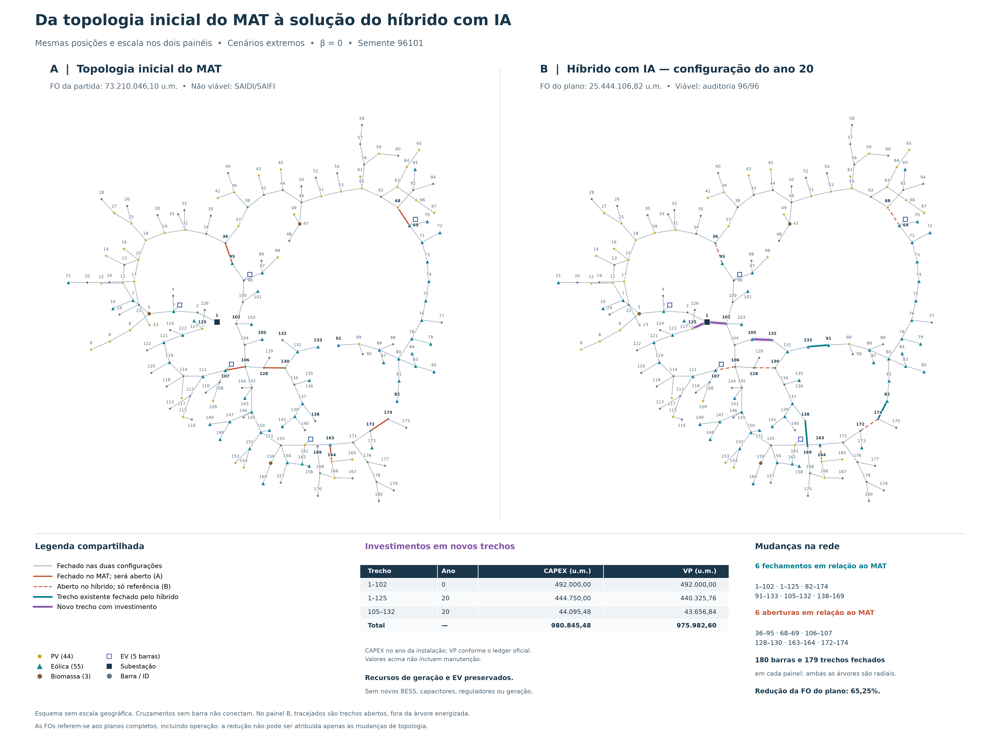

# Planejamento da expansão de redes de distribuição

Implementação original desenvolvida em pesquisa de mestrado para o planejamento de redes de distribuição com incerteza, aversão ao risco e recursos distribuídos. O projeto compara oito metaheurísticas e dois métodos híbridos, com avaliação física AC e uma base econômica fundamentada em Castro et al. (2024).

## O que o projeto faz

- Representa uma rede de 180 barras, com topologia de origem MAT e uma camada de cargas conciliadas.
- Decide reconfiguração, investimentos em linhas e recursos, geração P/Q, atendimento, DR, EV, BESS e controles físicos elegíveis.
- Considera investimentos nos anos 0, 10 e 20 e um horizonte econômico de 30 anos.
- Avalia viabilidade elétrica, restrições temporais e metas de confiabilidade antes de comparar custos.
- Registra candidatos, avaliações, tempo, orçamento, auditorias e origem dos resultados.

A formulação integra referências de Castro e Canizes a escolhas de representação, busca e avaliação desenvolvidas neste projeto. As referências fundamentam os componentes descritos na metodologia.

## Métodos implementados

| Família | Métodos | Característica |
|---|---|---|
| Busca nativa adaptada ao problema | PSO, HyDE, GA, ACO, Vortex, QPSO, SHADE e L-SHADE | Operadores próprios com representação, agenda de recursos e comparador compartilhados; sem refinador LP auxiliar nesses braços da comparação |
| Híbrido sem IA | `HYBRID` | Busca estruturada, refinamentos analíticos e programação linear, seguidos de avaliação AC completa |
| Híbrido com IA | `HYBRID_AI` | Acrescenta revisão de planos por IA ao núcleo híbrido; a IA não substitui a avaliação física nem altera FO ou restrições |

ACO identifica a adaptação de ACO para domínio contínuo. HyDE não deve ser confundido com HyDE-DF; esta última e GVNS/VND foram investigadas em testes separados. L-SHADE começa com oito membros e pode reduzir sua população para quatro.

## Base econômica

A política de seleção da comparação de referência é `CASTRO_ALIGNED_ANNUAL_WEIGHTED_v1`:

$$J=PC1_{VP}+(1-\beta)\,\mathbb{E}[C_{anual}]+\beta\,CVaR_{\alpha}(C_{anual}).$$

`PC1` reúne custos fixos em valor presente; a operação anual é ponderada entre estágios. Essa combinação é uma convenção explícita do estudo. VP30 e custo anual equivalente são apresentações separadas. Com β = 0, o CVaR continua disponível para análise, mas não orienta a seleção.

## Guia de leitura

| Documento | O que explica |
|---|---|
| [Escopo e arquitetura](docs/01_escopo_arquitetura.md) | Objetivo, camadas do sistema e organização do código |
| [Dados e modelo](docs/02_dados_modelo.md) | MAT, 90 cargas, Q, cenários, física, economia e BESS |
| [Métodos de busca](docs/03_metodos.md) | Funcionamento dos oito motores e dos híbridos, com e sem IA |
| [Protocolo experimental](docs/04_protocolo.md) | Partidas, sementes, orçamento, auditoria e comparação justa |
| [Instalação e reprodução](docs/05_reproducao.md) | Instalação, exemplo executável e configuração dos dez métodos |
| [Resultados de referência](docs/06_resultados.md) | Um conjunto completo dos dez métodos e a topologia ilustrativa |
| [Referências](docs/08_referencias.md) | Artigos-base e referências dos métodos |

## Exemplo de resultado auditado

No conjunto com partida MAT, cenários extremos, β = 0 e semente 96101, o híbrido com IA terminou com FO de **25.444.106,82 u.m.** e auditoria viável em 96/96 casos. Esse é um exemplo de uma semente, não uma conclusão geral de superioridade.



[Figura vetorial](assets/comparacao_mat_hibrido_ia.svg) · [Resultados dos dez métodos nesse mesmo conjunto](docs/06_resultados.md) · [Valores e identidades sem arredondamento](evidencias/recorte_pareado.json)

## Instalação e primeiro teste

Com Python 3.11, em um ambiente virtual, instale a partir da raiz do projeto:

```powershell
python -m pip install .
mestrado-grid methods
mestrado-grid prepare-demo --output exemplo --beta 0.5
mestrado-grid run --method PSO --study exemplo/study.json --population exemplo/population.npy --output execucao_pso --budget 88 --regime normal --case-kind synthetic
```

O exemplo contém uma rede sintética de três barras, 32 estados e três estágios. Cada execução utiliza uma pasta nova e termina com uma auditoria AC independente. Os mesmos comandos aceitam os outros métodos. `HYBRID_AI` utiliza o Codex CLI autenticado para obter planos de busca por inferência real.

Veja [instalação e reprodução](docs/05_reproducao.md) para entradas de pesquisa e [validação da distribuição](docs/09_validacao.md) para o alcance dos testes.

## Contribuição, citação e direitos

Consulte [CONTRIBUTING.md](CONTRIBUTING.md), [CITATION.cff](CITATION.cff) e [DIREITOS_E_CREDITOS.md](DIREITOS_E_CREDITOS.md).
