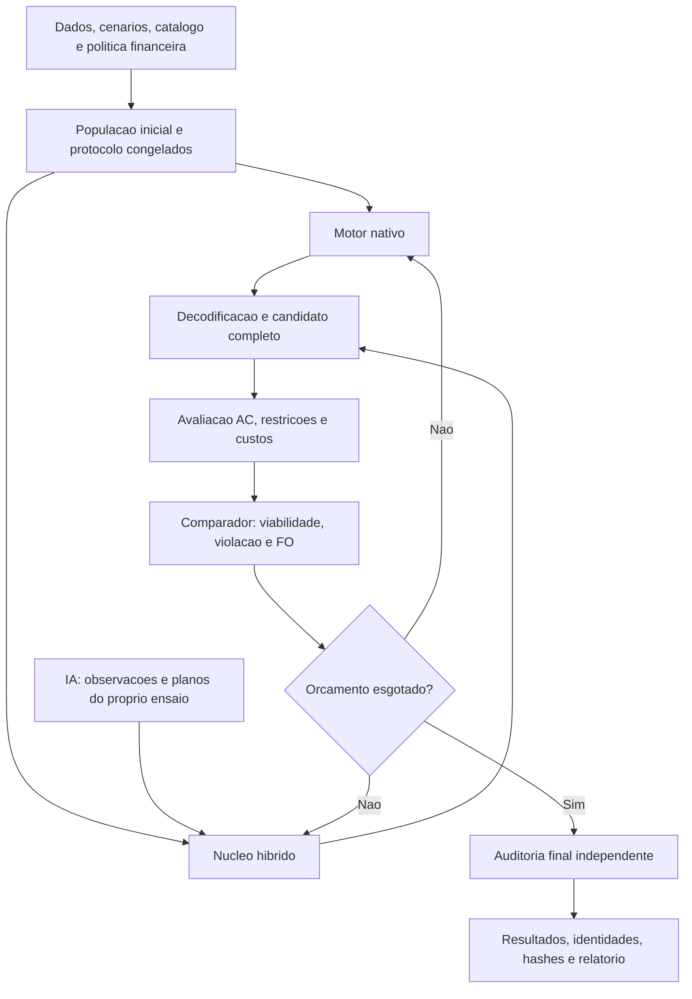

# Escopo e arquitetura

[Voltar ao início](../README.md)

## Objetivo científico

Estudar o planejamento da expansão de uma rede de distribuição em média tensão, considerando investimento, operação, recursos distribuídos, incerteza e risco. A comparação procura medir a capacidade de diferentes métodos de encontrar soluções viáveis e reduzir a função objetivo sob condições experimentais identificadas.

O objetivo não é apenas obter o menor número: resultado, base de dados, restrições, orçamento e método de obtenção precisam permanecer associados.

## Camadas funcionais

| Camada | Responsabilidade | Evidência atual |
|---|---|---|
| Dados | Importação, conciliação, cenários, catálogo e hipóteses | Pacotes de conciliação e entradas congeladas da comparação |
| Representação | Converter coordenadas de busca em plano e operação | `schema.py`, `codec.py`, `search_arrays.py` e módulos temporais |
| Avaliação | Fluxo AC, violações e contabilidade financeira | `evaluator.py`, `power_flow.py`, `physical.py`, `financial_policy.py` |
| Busca nativa | Propostas dos oito motores, contextos e agenda de recursos | Árvore congelada `native/`, incluindo `lshade_persistent.py` |
| Busca híbrida | Propostas físicas, refinamento P/Q e experimentos locais | Árvore congelada `hybrid/`, incluindo `complete_modes.py` e `reviewed_search.py` |
| Supervisão por IA | Revisar observações e propor planos de busca | Módulos de análise e política do híbrido; observações do próprio braço |
| Execução | Orçamento, fila, identidade e encerramento de cada ensaio | `worker.py`, interface de execução e identidades dos ensaios |
| Auditoria e relatório | Conferência independente e apresentação dos resultados | `validation.json.gz`, `summary.json`, históricos e relatórios |

O código científico está em `src/mestrado_grid/_vendor/`, organizado em dois núcleos: `native` e `hybrid`. O manifesto registra as identidades dos arquivos de referência. A interface `mestrado_grid` configura entradas, saídas e orçamento em processos independentes.



As duas ramificações representam alternativas de método. Cada ensaio usa uma delas, sem trocar candidatos com outros braços. A IA participa somente de `HYBRID_AI`.

## Organização do projeto

```text
README.md                         apresentação
pyproject.toml                    instalação e dependências
src/mestrado_grid/cli.py           interface de execução
src/mestrado_grid/worker.py        execução e contabilidade por método
src/mestrado_grid/_vendor/native/  oito metaheurísticas e avaliador
src/mestrado_grid/_vendor/hybrid/  híbridos com e sem IA
docs/                             metodologia, reprodução e resultados
tests/                            contratos e validações automatizadas
tools/                            verificadores
evidencias/                       resultados de referência e hashes
assets/                           figuras
```

Cada execução preserva uma cópia das entradas, a configuração, os históricos, o candidato final, os componentes financeiros e a auditoria. A interface exige uma pasta de saída nova. A versão científica dos resultados de referência e a camada de empacotamento são identificadas separadamente.
