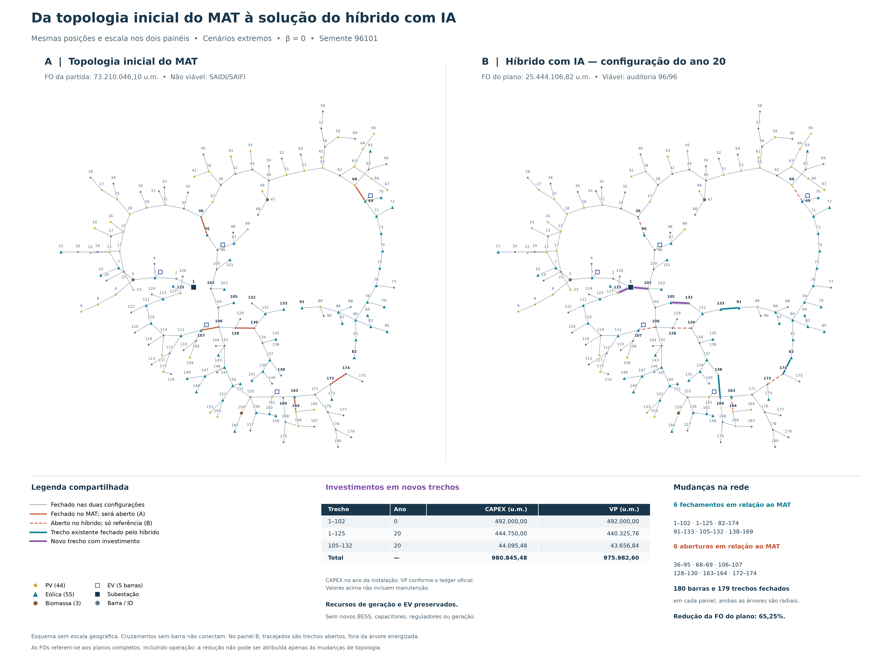

# Resultados de referência

[Voltar ao início](../README.md)

## Recorte completo de uma configuração

Partida **MAT**, cenários **extremos**, **α = 0,9**, **β = 0**, semente **96101**. Os dez métodos usaram a mesma população congelada, a mesma entrada e 4.104 avaliações completas, com uma auditoria final adicional por braço.

Os valores abaixo foram recuperados dos resumos e confrontados com as auditorias salvas. Todos os finais são viáveis em 96/96 casos, com as violações oficiais armazenadas iguais a zero. Não foi realizada uma nova avaliação AC para montar esta documentação.

| Método | FO final (u.m.) | Viável | Avaliações da busca | Soluções LP |
|---|---:|:---:|---:|---:|
| PSO | 71.814.085,42 | Sim | 4.104 | 0 |
| HyDE | 71.588.709,17 | Sim | 4.104 | 0 |
| GA | 76.726.851,56 | Sim | 4.104 | 0 |
| ACO | 83.753.596,49 | Sim | 4.104 | 0 |
| Vortex | 70.625.333,95 | Sim | 4.104 | 0 |
| QPSO | 71.052.175,51 | Sim | 4.104 | 0 |
| SHADE | 87.365.013,40 | Sim | 4.104 | 0 |
| L-SHADE | 69.628.188,08 | Sim | 4.104 | 0 |
| HYBRID | 25.626.691,87 | Sim | 4.104 | 1293 |
| HYBRID_AI | 25.444.106,82 | Sim | 4.104 | 1372 |

Dados exatos, tempos, componentes, identidades e hashes: [recorte pareado](../evidencias/recorte_pareado.json). Os resultados correspondem aos finais preservados desse conjunto; este documento não informa se algum processo está ativo.

## Como interpretar

A partida desse conjunto tinha FO de **73.210.046,10 u.m.**, mas violava metas de SAIDI/SAIFI. Assim, uma FO final maior que a inicial pode acompanhar a obtenção de viabilidade; não demonstra sozinha um erro de otimização.

Neste recorte, HYBRID_AI teve a menor FO, seguido por HYBRID. Os híbridos também executaram refinamentos LP que não existem nos braços nativos. A diferença entre híbridos e metaheurísticas não pode ser atribuída integralmente à IA.

O protocolo completo prevê 200 ensaios. Esta tabela cobre apenas dez, de uma semente e configuração. Não sustenta um ranking geral multissemente, prova de causalidade da IA ou garantia de ótimo global. As classes com β diferente devem permanecer em tabelas próprias.

## Topologia ilustrativa do híbrido com IA

[Versão vetorial](../assets/comparacao_mat_hibrido_ia.svg).

O painel final representa o **ano 20**. A FO de **25.444.106,82 u.m.** refere-se ao plano completo, incluindo operação. A melhoria não corresponde apenas à reconfiguração mostrada.

| Novo trecho | Ano da instalação | CAPEX no ano (u.m.) | CAPEX em VP (u.m.) |
|---|---:|---:|---:|
| 1–102 | 0 | 492.000,00 | 492.000,00 |
| 1–125 | 20 | 444.750,00 | 440.325,76 |
| 105–132 | 20 | 44.095,48 | 43.656,84 |
| **Total** | — | **980.845,48** | **975.982,60** |

Valores de investimento acima não incluem manutenção. São compras de três novos trechos do catálogo, não três substituições de linhas existentes. O plano final fecha seis trechos e abre seis em relação ao MAT, conservando uma árvore conectada com 180 barras e 179 trechos fechados.

As unidades existentes de PV, eólica, biomassa e os pontos EV são preservados. Este finalista não instala BESS, capacitores, reguladores ou geração adicional. Isso descreve a solução observada, não uma conclusão de que esses recursos são desnecessários em geral.

## Validade e rastreabilidade

A auditoria demonstra atendimento ao modelo, às tolerâncias e aos cenários registrados. Os [hashes de origem](../evidencias/fontes.json) ligam os números às fontes locais; a distribuição preserva a identificação de entrada, candidato, plano e versão científica de cada resultado apresentado.
